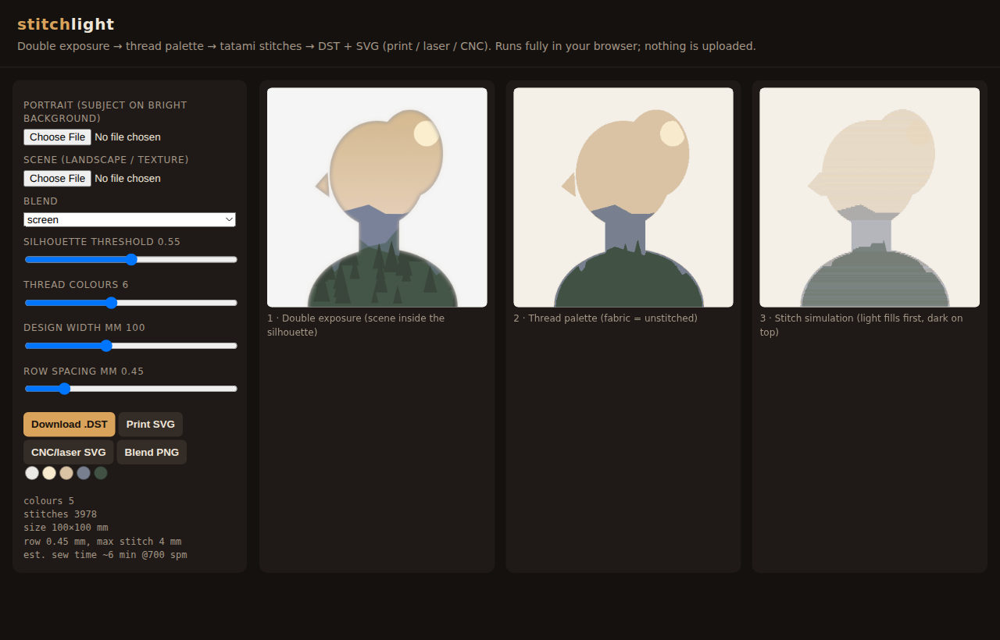
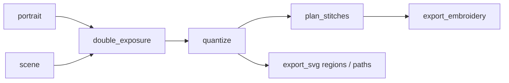

<!--
file_id: SOM-DOC-PENDING-v1.0.0
name: README.md
description: stitchlight — double exposure to embroidery, print, CNC and sewing.
project_id: STITCHLIGHT
category: doc
created: 2026-10-18
version: 1.0.0
agent_id: devin
-->
# stitchlight

Double exposure → thread palette → stitches. One pipeline produces:
- machine embroidery files: **DST · PES · EXP · JEF**;
- **print SVG**: filled colour regions;
- **CNC/laser SVG**: hairline outlines per colour.





## Use

```bash
pip install -r requirements.txt
python examples/make_fixtures.py          # synthetic, license-clean inputs
python -c "from stitchlight import run; print(run('examples/portrait.png','examples/scene.png','out'))"
```

The output folder gets:
- `double_exposure.png`
- `design.{dst,pes,exp,jef}`
- `print_regions.svg`
- `cnc_paths.svg`
- `stitch_preview.png`
- `summary.json`

## Browser demo

`demo/index.html` is a static page and runs entirely client-side: no upload, no build step. Serve it locally with `python -m http.server -d demo`, or from any static host. It writes DST directly in JavaScript.

## Status (measurement law)
- **PROVEN:**
  - end-to-end tests: all four formats re-read in pyembroidery, stitch length ≤ 4 mm, background left unstitched;
  - the browser demo's DST re-reads in pyembroidery with no page errors.
- **PLAUSIBLE:** density and row defaults. They follow common digitizing practice but haven't been sewn yet.
- **OWED:**
  - a real sew-out;
  - underlay, pull compensation and satin borders;
  - a CNC relief export.

See [docs/RESEARCH.md](docs/RESEARCH.md) for the method and the licensing notes.

MIT. Embroidery I/O by [pyembroidery](https://github.com/EmbroidePy/pyembroidery) (MIT).
