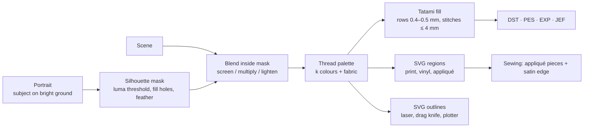

<!--
file_id: SOM-DOC-PENDING-v1.0.0
name: RESEARCH.md
description: Research notes: double exposure composition and the path image -> embroidery / print / CNC / sewing.
project_id: STITCHLIGHT
category: doc
created: 2026-10-18
version: 1.0.0
agent_id: devin
execution: founder chat 2026-10-18 "Make this a skill ... deep research where the double exposure and the idea of image to embroider to printing/cnc/emb/sew/skill lands"; stamp PENDING (Witness assigns)
-->
# Research: double exposure → thread, ink, cut and seam

**Source prompt.** Cliff Wade, X post 2111940533857783862: "QT or Share your Double Exposure Art". It has one 1536×1024 image: a woman in profile whose silhouette holds a coastal landscape, a cottage and a flower garden, in warm, low-contrast tones. We only describe that artwork here; it isn't redistributed in this repo.

## 1. What makes a double exposure read

- **The silhouette carries the composition.** In-camera double exposure works because the subject is under-exposed against a bright sky. The dark figure keeps the second frame and the bright ground erases it. The digital version is the same: take a mask from portrait luminance, then show the scene only inside it.
- **Screen is the default blend** (`1-(1-a)(1-b)`): it brightens like a second exposure on film. Multiply suits dark, graphic results; lighten keeps the brightest of both images.
- **Edge feathering** (a few pixels of Gaussian blur on the mask) gives the soft photographic transition. Hard edges read as a cut-out.
- **The background becomes paper or fabric.** For fabrication, the unstitched ground is a design element, not something to fill.

## 2. Image → embroidery: the constraints

| Constraint | Typical value | Why it matters | In stitchlight |
|---|---|---|---|
| Thread colours | 4–12 per design | Every colour is a manual thread change or a needle on a multi-needle machine | `colors` (default 6) |
| Stitch length | 0.4 to about 7 mm (max ~12.1 mm in DST) | Long stitches snag; short ones bunch the fabric | 4 mm cap with headroom for stagger |
| Fill row spacing | 0.35–0.5 mm (~4 rows per mm) | Density: too tight puckers or breaks needles, too loose shows fabric | `row_mm` 0.45 |
| Stagger | 1/3 offset per row | Avoids a visible seam line in tatami fills | `(row % 3)/3` |
| Order | light → dark | Dark detail sits on top and covers the edges of light fills | Palette sorted by luminance |
| Minimum region | ~1 mm² | Specks can't be stitched cleanly | `min_region_px` |
| Units | 0.1 mm | DST/EXP coordinate unit | `MM = 10` |

- **What stitchlight doesn't do yet:** underlay (a sparse stitch layer that stabilises the fabric before the fill), pull compensation (the fabric shrinks across the stitch direction, so shapes are widened about 0.2–0.4 mm), and satin borders. The next version should add them. They are the difference between a good preview and a good sew-out. Status: OWED, needs a real sew-out to tune.
- **Formats:**
  - **DST** (Tajima) is the universal machine format: stitch and jump records only, no colour info, with colours given on the run sheet.
  - **PES** (Brother) and **JEF** (Janome) carry threads.
  - **EXP** (Melco) is a minimal format.
  - All of them are written by the MIT-licensed `pyembroidery`. The browser demo writes DST natively in JavaScript, and its output re-reads in pyembroidery: 3,979 stitches, 4 colour changes, within 100 mm. Status: PROVEN.

## 3. The same artwork as print, cut and CNC

- **Print / DTF / screen:** `print_regions.svg` has one filled path per thread colour, sized in millimetres. One path per colour means one screen per colour in screen printing.
- **Laser / drag knife / vinyl / pen plotter:** `cnc_paths.svg` has the same regions as hairline stroked outlines, with one colour per operation. That's how the common laser tools map colours to power and speed.
- **CNC router / relief:** use the palette index as a height map, light = high, to get a stepped relief carving of the double exposure. This is a natural next export. Status: PLAUSIBLE.

## 4. Sewing: appliqué as a large-format exposure

- At jacket-back or quilt scale, filling every region with stitches is slow and stiff.
- Instead, cut the large regions from fabric using `cnc_paths.svg` on a cutting machine, fuse them down, and finish the edges with a satin or zig-zag outline.
- Keep fine detail (eyes, branches) as embroidery fill.
- Status: OWED until we do a real sew-out.

## 5. Licensing

| Component | License | How it's used |
|---|---|---|
| pyembroidery | MIT | Runtime dependency for file writing |
| Ink/Stitch | GPL-3.0 | Ideas only; no code taken |
| Inputs | Synthetic fixtures generated in `examples/make_fixtures.py` | — |
| Cliff Wade's artwork | Not redistributed | Described only |
